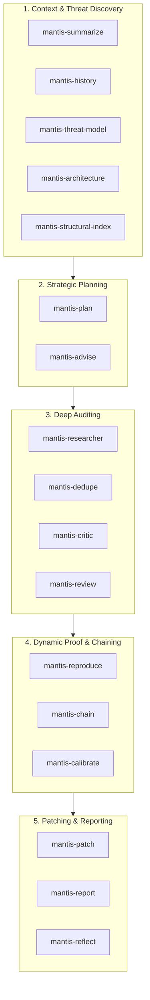

# Google Mantis Security Suite

**Mantis** is Google's open-source, modular agentic toolkit and autonomous vulnerability management framework for finding, reproducing, validating, and patching software vulnerabilities.

This project includes all 21 modular Mantis skills organized under `.agents/skills/`.

---

## The Mantis Lifecycle & Skill Map

---

## Complete Skills Directory (21 Modular Skills)

| Skill | Directory | Primary Role |
| :--- | :--- | :--- |
| **`mantis-advise`** | [`.agents/skills/mantis-advise`](../mantis-advise/SKILL.md) | Proactive security advisor and architectural remediation guidance before code edits. |
| **`mantis-architecture`** | [`.agents/skills/mantis-architecture`](../mantis-architecture/SKILL.md) | Synthesizes codebase analysis into an interlinked Markdown Knowledge Base. |
| **`mantis-calibrate`** | [`.agents/skills/mantis-calibrate`](../mantis-calibrate/SKILL.md) | Calculates objective risk scores based on empirical evidence and system impact. |
| **`mantis-chain`** | [`.agents/skills/mantis-chain`](../mantis-chain/SKILL.md) | Combines single findings into multi-step exploit chains across trust boundaries. |
| **`mantis-configure`** | [`.agents/skills/mantis-configure`](../mantis-configure/SKILL.md) | Auto-detects environment, model endpoints, and validates preflight configuration. |
| **`mantis-critic`** | [`.agents/skills/mantis-critic`](../mantis-critic/SKILL.md) | Filters out test/debug-only artifacts, false positives, and assertion traps. |
| **`mantis-dedupe`** | [`.agents/skills/mantis-dedupe`](../mantis-dedupe/SKILL.md) | Merges duplicate vulnerability reports sharing root-cause origins. |
| **`mantis-history`** | [`.agents/skills/mantis-history`](../mantis-history/SKILL.md) | Mines Git commit history to analyze past security vulnerabilities and fix patterns. |
| **`mantis-launch`** | [`.agents/skills/mantis-launch`](../mantis-launch/SKILL.md) | Launches focused or full vulnerability review campaigns. |
| **`mantis-meta-agent`** | [`.agents/skills/mantis-meta-agent`](../mantis-meta-agent/SKILL.md) | Persistent supervisor coordinating continuous security review cycles. |
| **`mantis-patch`** | [`.agents/skills/mantis-patch`](../mantis-patch/SKILL.md) | Generates minimal, isolated security patches and verifies remediation against re-attack. |
| **`mantis-pipeline-adapter`** | [`.agents/skills/mantis-pipeline-adapter`](../mantis-pipeline-adapter/SKILL.md) | Guides design and implementation of custom deterministic orchestrators. |
| **`mantis-plan`** | [`.agents/skills/mantis-plan`](../mantis-plan/SKILL.md) | Synthesizes target threat models and codebase history into an audit plan. |
| **`mantis-reflect`** | [`.agents/skills/mantis-reflect`](../mantis-reflect/SKILL.md) | Extracts learnings and trajectory invariants across execution passes. |
| **`mantis-report`** | [`.agents/skills/mantis-report`](../mantis-report/SKILL.md) | Generates structured, human-readable security reports from confirmed findings. |
| **`mantis-reproduce`** | [`.agents/skills/mantis-reproduce`](../mantis-reproduce/SKILL.md) | Creates and executes isolated dynamic reproducers (PoCs) to verify vulnerabilities. |
| **`mantis-researcher`** | [`.agents/skills/mantis-researcher`](../mantis-researcher/SKILL.md) | Exhaustively audits production source code against identified threat surfaces. |
| **`mantis-review`** | [`.agents/skills/mantis-review`](../mantis-review/SKILL.md) | Independent code reviewer verifying candidate findings against false positives. |
| **`mantis-structural-index`** | [`.agents/skills/mantis-structural-index`](../mantis-structural-index/SKILL.md) | Builds semantic index trees from source code for context-aware analysis. |
| **`mantis-summarize`** | [`.agents/skills/mantis-summarize`](../mantis-summarize/SKILL.md) | Generates security-focused directory summaries to accelerate scanning. |
| **`mantis-threat-model`** | [`.agents/skills/mantis-threat-model`](../mantis-threat-model/SKILL.md) | Defines trust boundaries, entry points, assets, and threat actors for the project. |

---

## Core Security Invariants (INV-1 - INV-6)

When using Mantis skills on this codebase, always adhere to the 6 core invariants:
1. **INV-1 (Objective Evidence)**: Every finding must identify a verified source-to-sink dataflow or concrete exploit path.
2. **INV-2 (Re-Attack Verification)**: Patches must be validated against a reproducer to prove the vulnerability is neutralized.
3. **INV-3 (Regression Tracking)**: Fixes must not break existing functionality or introduce behavioral regressions.
4. **INV-4 (Target Immutability)**: Auditing operates non-destructively; mutations are confined to sandboxes.
5. **INV-5 (State Resumption)**: Review state, findings, and checkpoints are stored monotonically.
6. **INV-6 (Fail-Safe Defaults)**: Unclear findings fail closed as requiring human validation rather than being dismissed.
