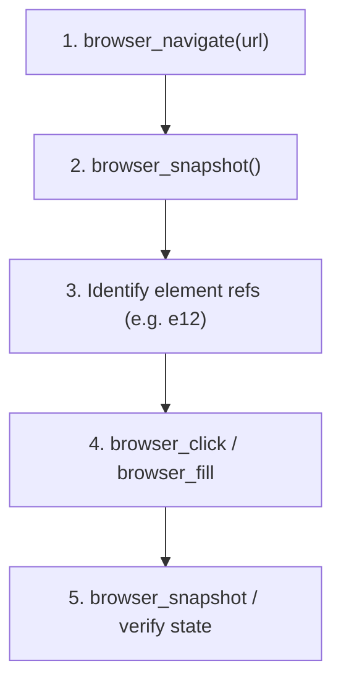

# Microsoft Playwright MCP Server & Browser Automation

**Playwright MCP** provides automated browser capabilities over the Model Context Protocol, enabling structured web interactions through accessibility snapshots without relying on brittle pixel-based vision models.

---

## Capabilities & Toolset

### 1. Navigation & State
- `browser_navigate`: Navigate to target URLs (e.g., `http://localhost:3000`).
- `browser_snapshot`: Capture accessibility trees with element references (`e1`, `e2`, `e3`).
- `browser_screenshot`: Capture full-page or element screenshots for visual inspection.
- `browser_console_messages`: Monitor browser console logs, warnings, and errors.
- `browser_close`: Terminate browser session.

### 2. Interaction
- `browser_click`: Click on buttons, links, or inputs using element reference IDs or CSS selectors.
- `browser_fill`: Clear and type text into input/textarea fields.
- `browser_type`: Type keystrokes with realistic delay.
- `browser_press`: Press specific keys (e.g., `Enter`, `Tab`, `Escape`).
- `browser_select_option`: Choose values in dropdowns.
- `browser_check` / `browser_uncheck`: Toggle checkboxes and radio buttons.
- `browser_drag` / `browser_drop`: Perform drag-and-drop operations and file uploads.
- `browser_evaluate`: Evaluate custom JavaScript in page context.

---

## Standard Workflow



### Example: Testing a Login / Form Flow

1. **Navigate**:
   ```json
   { "url": "http://localhost:3000/auth" }
   ```
2. **Inspect Snapshot**:
   Identify input fields:
   - `e1`: Username / Phone input
   - `e2`: Password input
   - `e3`: Submit button
3. **Fill & Submit**:
   ```json
   // Fill username
   { "target": "e1", "value": "0712345678" }
   // Fill password
   { "target": "e2", "value": "securePassword123" }
   // Click submit
   { "target": "e3" }
   ```
4. **Verify Outcome**:
   Take snapshot to confirm navigation to dashboard or display of success toast.

---

## Invariants & Best Practices

1. **Accessibility First**: Always favor element references from structured snapshots over fragile hardcoded XPath or nested selectors.
2. **Console Hygiene**: Inspect `browser_console_messages` after navigation and form submissions to catch unhandled errors or API rejections.
3. **Responsive Testing**: Emulate mobile and desktop viewports to ensure cross-device fidelity.
