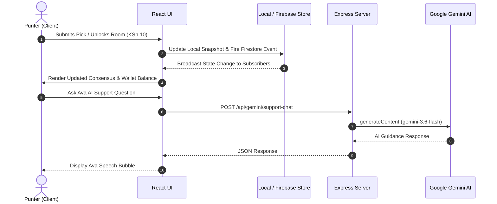

# System Architecture Specification

## 1. Executive Summary

**Mshindi Projo** (Mshindi Room) is designed as a hybrid full-stack web application combining a React 18 single-page application (SPA) with an Express.js backend server, backed by Firebase Firestore real-time cloud data storage and local state subscription stores.

---

## 2. High-Level Architecture Diagram

```mermaid
graph TD
    Client[Browser / PWA Client] -->|HTTPS / Port 3000| ReverseProxy[Cloud Run / NGINX Reverse Proxy]
    ReverseProxy --> Server[Express Node.js Server]
    
    subgraph Frontend [React 18 Client Layer]
        App[App.tsx Router]
        Pages[Pages: Home, Room, Wallet, P2P, etc.]
        Stores[Zustand Stores & External Snapshots]
        Components[UI Components & Modals]
    end
    
    subgraph Backend [Express API & Middleware Layer]
        RateLimiter[Rate Limiter Middleware]
        HealthAPI[/api/health]
        JackpotMirror[/api/jackpots/mirror]
        GeminiAva[/api/gemini/support-chat]
        GeminiAdvisor[/api/gemini/advisor]
        GeminiParser[/api/gemini/parse-jackpot-text]
    end

    subgraph External [External Services & Data]
        GeminiSDK[Google GenAI SDK - gemini-3.6-flash]
        Firebase[Firebase Firestore & Auth]
        MirrorScraper[Jackpot Mirror Scraper Service]
    end

    Server --> Frontend
    Server --> Backend
    GeminiAva --> GeminiSDK
    GeminiAdvisor --> GeminiSDK
    GeminiParser --> GeminiSDK
    JackpotMirror --> MirrorScraper
    Client --> Firebase
```

---

## 3. Data Flow & Subscriptions



---

## 4. Key Subsystems

### 4.1 Slip Consensus Engine (`src/lib/consensusEngine.ts`)
Calculates real-time percentage distribution for Home (1), Draw (X), and Away (2) outcomes across all submissions for 15–17 leg jackpots. Aggregates community picks, computes agreement indices, and ranks punters based on closest predictions.

### 4.2 5-Star Punter Rating Engine (`src/lib/ratingEngine.ts`)
Computes a dynamic star rating (1.0 to 5.0) based on:
- Historical settled jackpot slip accuracy
- Mshindi Crown victories (weekly #1 rank)
- Inactivity decay over time

### 4.3 Ava AI Support & Guide (`server.ts`)
Powered by Google Gemini 3.6 Flash. Operates server-side to proxy user queries while keeping the API key secret. Configured with strict system prompts regarding KSh 10 room fees, sports analytics rules, and Kenyan customer support tone.

### 4.4 Wallet & M-Pesa STK Push (`src/lib/store.ts` & `src/lib/mpesa.ts`)
Manages user balances, room unlock fees (KSh 10), P2P wager stakes, and deposit/withdrawal ledgers with M-Pesa phone prompt simulations.

---

## 5. Routing Architecture

Routing is managed via `react-router-dom` in `src/App.tsx`:

| Route | Component | Guard / Access | Purpose |
| :--- | :--- | :--- | :--- |
| `/` | `Home.tsx` | Public | Active jackpots, daily matches, top punters, news |
| `/room/:roomId` | `Room.tsx` | PayGate / KSh 10 | Jackpot Consensus Room & live slip generator |
| `/free` | `FreeMatches.tsx` | Public | Free match prediction rooms index |
| `/free/:roomId` | `FreeMatchRoom.tsx` | Public | Match specific discussion & consensus room |
| `/p2p` | `P2PBets.tsx` | Public / Auth | P2P 1v1 wagers list & creation |
| `/betslip` | `BetSlipRoom.tsx` | Public | Social bet slip sharing and discussion feed |
| `/wallet` | `WalletPage.tsx` | Auth Required | M-Pesa deposit, withdrawal, and transaction ledger |
| `/leaderboard` | `Leaderboard.tsx` | Public | Gameweek Leaderboard & Punter Star Rankings |
| `/profile` | `Profile.tsx` | Auth Required | Punter profile, avatar picker, stats, PWA install |
| `/auth` | `Auth.tsx` | Public | Phone OTP login & account creation |
| `/how-it-works` | `HowItWorks.tsx` | Public | Platform rules, pricing, and tutorial guide |

---

## 6. Security & State Isolation

1. **Server-Side API Key Concealment**: `GEMINI_API_KEY` is loaded exclusively inside `server.ts` and never passed to client bundles.
2. **Rate Limiting**: Express middleware applies sliding-window rate limits (120 reqs/min for general API, 20 reqs/min for Gemini AI).
3. **Profanity & Content Moderation**: Client and server sanitization blocks offensive language, phone number spam, and illegal links before database persistence.
