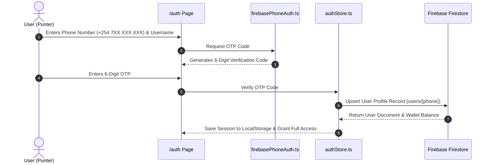

# Authentication Specification

## 1. Overview

Mshindi Projo utilizes a multi-layered authentication strategy combining **Kenyan Phone Number SMS OTP Authentication**, **Firebase Anonymous Auth**, and persistent **Local Storage Account Snapshots**.

---

## 2. Authentication Architecture



---

## 3. Account Data Structure (`src/lib/authStore.ts`)

```typescript
export interface User {
  id: string;             // Unique Punter Identifier
  phone: string;          // Verified Kenyan Phone Number (+254...)
  username: string;       // Public Display Username
  avatarId: string;       // Avatar Preset Identifier
  balance: number;        // Wallet Balance in KSh
  joinedAt: string;       // ISO Registration Timestamp
  isVerified: boolean;    // OTP Phone Verification Status
  isVIP?: boolean;        // VIP Access Flag
  stars?: number;         // Punter Rating (1.0 to 5.0 stars)
}
```

---

## 4. Protected Routes & Permissions

Page access control is enforced via React components reading `useCurrentUser()` from `authStore.ts`:

- **Public Routes**: Home (`/`), How It Works (`/how-it-works`), Leaderboard (`/leaderboard`), Free Matches (`/free`).
- **PayGate Protected Routes**: Jackpot Consensus Rooms (`/room/:roomId`) require KSh 10 unlock via M-Pesa, wallet balance, or Mshindi Tokens.
- **Auth Required Routes**: Wallet (`/wallet`), Profile (`/profile`), Create P2P Wager (`/p2p`), Bet Slip Submission (`/betslip`).

If an unauthenticated user attempts to perform a protected action, they are redirected to `/auth` with a toast prompt.
