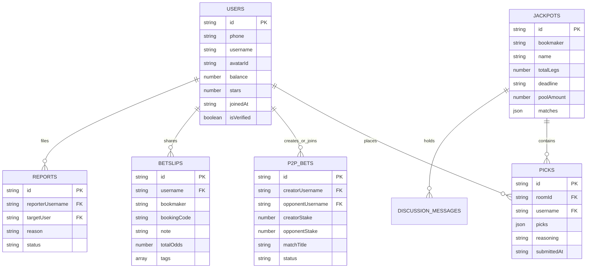

# Database Architecture & Schema Reference

## 1. Overview

Mshindi Projo uses **Firebase Firestore** as its cloud database engine, coupled with `useSyncExternalStore` in-memory state snapshots for high-speed client-side rendering and offline access.

---

## 2. Entity Relationship Diagram (ERD)

---

## 3. Collection Specifications

### 3.1 Collection: `users`
- **Purpose**: Stores registered punter profile records, balance ledgers, and rating stars.
- **Document ID (PK)**: `phone` or `userId`.
- **Fields**:
  - `id`: `string` — Unique user identifier
  - `phone`: `string` — Phone number (+254...) [Unique Index]
  - `username`: `string` — Public punter handle
  - `avatarId`: `string` — Selected avatar icon ID
  - `balance`: `number` — Wallet balance in KSh
  - `stars`: `number` — Calculated rating (1.0 - 5.0)
  - `joinedAt`: `string` — ISO timestamp
  - `isVerified`: `boolean` — Phone verification flag

### 3.2 Collection: `jackpots`
- **Purpose**: Stores active and historical jackpot competitions (SportPesa, Betika, etc.).
- **Document ID (PK)**: `jackpotId` (e.g. `sportpesa-mega-17`).
- **Fields**:
  - `id`: `string` — Competition ID
  - `bookmaker`: `string` — Sportsbook brand name
  - `name`: `string` — Competition title (e.g., "SportPesa Mega Jackpot")
  - `totalLegs`: `number` — Number of match legs (15 or 17)
  - `deadline`: `string` — Lockout timestamp
  - `poolAmount`: `number` — Total prize pool in KSh
  - `matches`: `array<MatchFixture>` — List of leg fixtures and odds

### 3.3 Collection: `picks` (Consensus Submissions)
- **Purpose**: Individual punter submissions for jackpot consensus rooms.
- **Document ID (PK)**: `{roomId}_{username}`.
- **Fields**:
  - `id`: `string` — Record identifier
  - `roomId`: `string` — Target jackpot room ID
  - `username`: `string` — Submitting punter handle
  - `picks`: `map<number, string>` — Map of leg index to outcome (`1`, `X`, `2`)
  - `reasoning`: `string` — Analysis commentary
  - `submittedAt`: `string` — Submission timestamp

### 3.4 Collection: `p2p_bets`
- **Purpose**: 1v1 custom peer-to-peer wager contracts.
- **Document ID (PK)**: `betCode` (e.g., `MSH-9821`).
- **Fields**:
  - `id`: `string` — Bet contract code
  - `creatorUsername`: `string` — Wager creator
  - `opponentUsername`: `string` — Challenged/accepting punter
  - `creatorStake`: `number` — Creator stake in KSh
  - `opponentStake`: `number` — Opponent stake in KSh
  - `matchTitle`: `string` — Wager event title
  - `creatorSidePick`: `string` — Creator predicted side
  - `opponentSidePick`: `string` — Opponent predicted side
  - `status`: `string` — `open` | `matched` | `settled_creator_won` | `settled_opponent_won` | `cancelled`

### 3.5 Collection: `betslips` (Community Shared Slips)
- **Purpose**: Community shared bookmaker booking codes and slip notes.
- **Document ID (PK)**: Auto-generated string.
- **Fields**:
  - `id`: `string` — Slip post ID
  - `username`: `string` — Sharer handle
  - `bookmaker`: `string` — Bookie name (1xBet, Betika, Mozzart, etc.)
  - `bookingCode`: `string` — Slip share code
  - `totalOdds`: `number` — Total slip odds multiplier
  - `note`: `string` — Analysis note
  - `likes`: `array<string>` — List of usernames who liked
  - `createdAt`: `string` — Posting timestamp

---

## 4. Security Rules (`firestore.rules`)

Security policies restrict database access:
- Public read access is granted for active `jackpots` and `picks`.
- Write access for `picks`, `p2p_bets`, and `users` is restricted to authenticated punters for their own documents.
