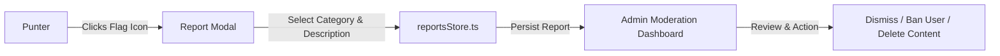

# Content Moderation Specification

## 1. Overview

Mshindi Projo maintains a safe community by moderating user-generated text across room discussion chats, bet slip notes, P2P wager descriptions, and usernames.

---

## 2. Automated Moderation Engine (`src/lib/contentModeration.ts`)

Every user text input is processed through `moderateText(inputStr)` before database submission.

### 2.1 Filter Rules
1. **Profanity & Swear Filter**: Regex patterns matching offensive language in Swahili, Sheng, and English.
2. **Phone Number & Contact Harvesting**: Rejects phone numbers (+254, 07XX, 011X) to prevent off-platform scams.
3. **Unapproved Promotional Links & Telegram Spam**: Blocks external URLs (`t.me/`, `wa.me/`, `bit.ly/`, unverified WhatsApp groups).

### 2.2 Result Schema
```typescript
export interface ModerationResult {
  isAllowed: boolean;      // true if text passes safety checks
  reason?: string;         // Explanation if rejected (e.g., "Contains prohibited phone number")
  flaggedTerms?: string[]; // Array of identified problematic terms
}
```

If `isAllowed` is `false`, the submission is rejected with a warning banner (`src/components/ModerationWarningBox.tsx`).

---

## 3. Reporting Workflow (`src/components/ReportModal.tsx`)

Punters can flag inappropriate content or suspicious users:



### Report Reason Categories:
- Fraud / Scam / Off-platform betting group promotion
- Harassment or abusive language
- Fake booking codes / misleading odds
- Impersonation of verified punters

---

## 4. Admin Moderation Dashboard (`src/components/AdminModerationDashboard.tsx`)

Accessible via the profile screen for admin roles (`isAdmin = true`):
- **Pending Reports**: Review reported chat messages, bet slips, and user profiles.
- **Banned Words Dictionary**: Add or remove custom blocked keywords in real-time.
- **Audit Logs**: Track historical moderator actions.
