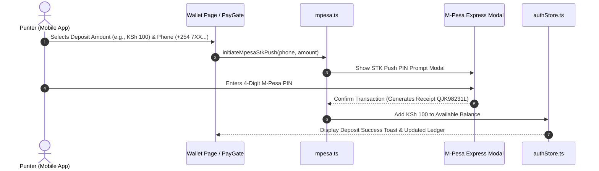

# Payments & M-Pesa Integration Specification

## 1. Overview

Mshindi Projo integrates with Safaricom **M-Pesa Express (STK Push)** for mobile money deposits, withdrawals, and instant jackpot room unlocks.

---

## 2. Payment Flow Architecture



---

## 3. Current Implementation (`src/lib/mpesa.ts`)

In the current web preview environment, M-Pesa STK Push is executed via an interactive, realistic STK PIN prompt modal (`src/components/PayGate.tsx` / `src/components/PinInput.tsx`):

- **Prompt**: Displays authentic Safaricom M-Pesa payload details ("Pay KSh 10.00 to Mshindi Projo Paybill 400200").
- **Verification**: User inputs 4-digit PIN.
- **Receipt Generation**: Generates 10-character alphanumeric transaction receipt code (e.g., `QJK82910M`).

---

## 4. Production Webhook Architecture (Planned / Daraja API Specification)

When deploying to production with live Safaricom Daraja 2.0 API:

### 4.1 STK Push Request Endpoint
`POST https://api.safaricom.co.ke/mpesa/stkpush/v1/processrequest`

### 4.2 Callback Webhook Handler (`POST /api/payments/mpesa-callback`)
```json
{
  "Body": {
    "stkCallback": {
      "MerchantRequestID": "29115-3462056-1",
      "CheckoutRequestID": "ws_CO_0308202611223344",
      "ResultCode": 0,
      "ResultDesc": "The service request is processed successfully.",
      "CallbackMetadata": {
        "Item": [
          { "Name": "Amount", "Value": 100.00 },
          { "Name": "MpesaReceiptNumber", "Value": "QJK82910M" },
          { "Name": "PhoneNumber", "Value": 254712345678 }
        ]
      }
    }
  }
}
```

### 4.3 Error Codes & Handling
- `1032`: Cancelled by user — display "Payment cancelled on phone" toast.
- `1037`: Timeout waiting for PIN input — prompt retry.
- `1`: Insufficient funds — prompt user to top up M-Pesa balance.
