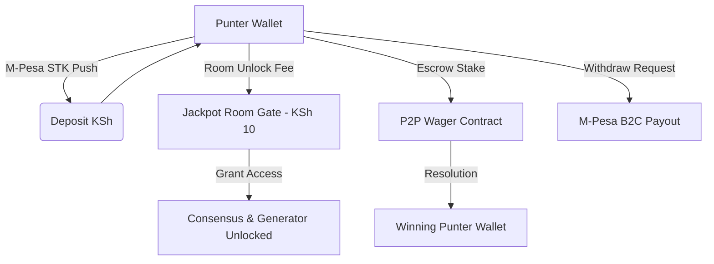

# Wallet & Token Balance Architecture

## 1. Overview

The Wallet Subsystem manages all punter funds, room unlock payments, P2P wager escrows, and transaction history.

- **Primary Currency**: Kenyan Shilling (KSh)
- **Secondary Asset**: Room Tokens / Bonus Credits
- **Flat Room Unlock Fee**: Strictly **KSh 10** per jackpot room

---

## 2. Wallet Data Model (`src/lib/store.ts` & `src/lib/types.ts`)

```typescript
export interface WalletState {
  balance: number;                   // Available balance in KSh
  unlockedRooms: string[];          // List of unlocked jackpot room IDs
  transactions: Transaction[];       // Immutable transaction ledger
}

export interface Transaction {
  id: string;                       // Transaction ID (e.g., TX-1789)
  type: 'deposit' | 'withdrawal' | 'room_unlock' | 'p2p_wager' | 'p2p_payout';
  amount: number;                    // Amount in KSh
  description: string;               // Purpose details
  timestamp: string;                 // ISO 8601 string
  status: 'completed' | 'pending' | 'failed';
  mpesaReceipt?: string;            // M-Pesa Transaction Code (e.g. QJK892L1)
}
```

---

## 3. Transaction Types & Flow



---

## 4. Business Rules

1. **Room Unlocks**:
   - Every jackpot room costs **KSh 10** flat fee.
   - Once paid, access is saved in `unlockedRooms` array and persisted in local state & Firestore.
   - Punters can alternative unlock rooms by watching a rewarded video ad.

2. **P2P Escrow**:
   - Creating or joining a P2P wager locks the required stake (`creatorStake` or `opponentStake`) from the user's available balance into escrow.
   - Cancelling an unmatched P2P wager automatically refunds the creator's full stake.

3. **Ledger Integrity**:
   - Balances cannot drop below KSh 0.
   - Every balance modification generates an immutable transaction record.
